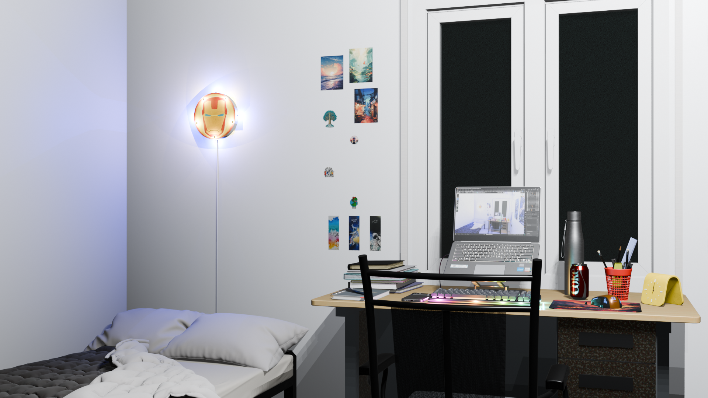
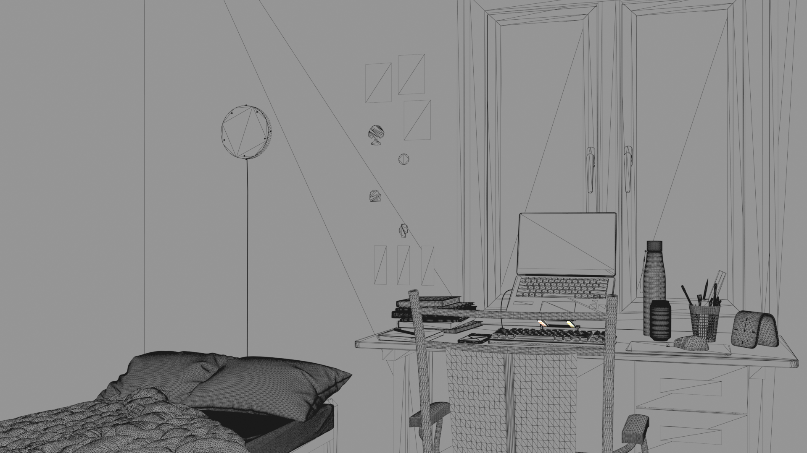

# 3D IITJ Hostel Room

An interactive, 360-degree web environment of my IIT Jodhpur hostel room, built to run smoothly directly in the browser. 

*(Live Demo Link: Add your Vercel link here once deployed)*

## The Setup
Everything was modeled, textured, and fully baked in Blender, then brought to the web using **Three.js** and **Next.js**. 

To achieve maximum performance and prevent the need for users to download raw `.glb` geometry, this scene utilizes an **Equirectangular Projection**. The environment was rendered as a highly distorted 4K 360° image and mathematically mapped to the inside of a Three.js sphere to create a seamless "Street View" experience.

## Asset Pipeline & Optimization 
To make this run at a buttery-smooth 60fps in the browser:
* **Strictly Low-Poly:** Topology was kept extremely minimal.
* **Baked Lighting:** All ambient occlusion, direct lights, and soft shadows were baked directly into the texture atlas. Zero real-time lighting calculations happen in the browser.

### Render vs Wireframe

  
  

## Tech Stack
* **3D Modeling & Rendering:** Blender (Cycles & EEVEE)
* **Web Engine:** Three.js / React Three Fiber
* **Framework:** Next.js (App Router)